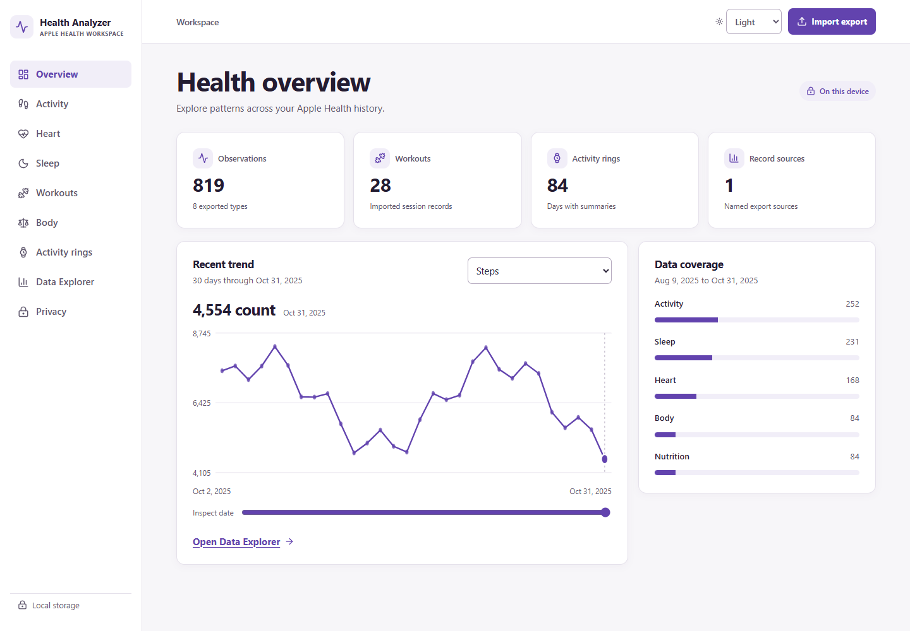

# Apple Health Analyzer

Explore Apple Health exports on your own computer. Import a ZIP or XML file, review trends and data coverage, and compare metrics with access to the source observations behind them.



## Run locally

Install Python 3.11–3.14 and Node.js 24, then run these commands from the repository root.

```sh
python -m pip install -e .
npm --prefix frontend ci
npm --prefix frontend run build
python -m apple_health_dashboard.cli serve
```

Open **http://127.0.0.1:8000**. Choose **Try synthetic demo** and confirm the preview to explore a fictional profile, or use **Import export**. In Apple Health on iPhone, open your profile and choose **Export All Health Data** to create a ZIP. The analyzer accepts that ZIP or its `export.xml`.

For frontend development, keep the API running and start `npm --prefix frontend run dev`. Open **http://localhost:5173**. Vite forwards API requests to loopback port 8000. The local OpenAPI schema is available at **http://127.0.0.1:8000/api/openapi.json**.

## Explore the data

- **Overview** shows imported coverage, source counts, and a selectable recent trend.
- **Activity, heart, and body** offer source filters and daily, weekly, and monthly views of supported metrics.
- **Sleep** merges overlapping asleep intervals and reports time assigned to unambiguous stages.
- **Workouts and rings** show session history, reported quantities, and exported Apple Activity summaries.
- **Data Explorer** aligns two metric charts on the selected dates, shows distributions, offers descriptive Pearson correlation on shared daily observations, pages through raw records, and exports aggregates as CSV.

The [desktop Explorer](docs/screenshots/explorer.png) and [mobile dark theme](docs/screenshots/sleep-mobile.png) screenshots use the bundled synthetic data.

## Storage and privacy

One loopback FastAPI process serves the built React app. DuckDB stores the profile as `health.duckdb` in the directory where you start the server. Imports use local disk and memory. The application ships with no telemetry, remote fonts, accounts, or external analytics. Keep the working directory outside cloud-sync folders if you want the files to stay on this device.

Stop the server before backing up or removing the profile. Back up `health.duckdb` before the first run with a new version. For application-managed deletion, run `python -m apple_health_dashboard.cli clear --yes` from the same directory. This removes the profile, its write-ahead log and spill files, and staged previews. Your original export and any CSVs you downloaded are managed separately.

## Engineering notes

| Guide | Contents |
| --- | --- |
| [Architecture decision](docs/architecture/REBUILD_DECISION.md) | Baseline audit, alternatives, and migration decision |
| [Architecture](docs/architecture/ARCHITECTURE.md) | Local process, modules, and privacy boundaries |
| [Data pipeline](docs/architecture/DATA_PIPELINE.md) | Supported inputs, schema, migration, and provenance |
| [Metric methods](docs/METRICS.md) | Units, calendar rules, exclusions, and interpretation |
| [Testing and benchmarks](docs/TESTING.md) | Reproducible checks and measured results |
| [Implementation status](docs/IMPLEMENTATION_STATUS.md) | Delivered scope and remaining limitations |

Apple Health measurements are used here for descriptive exploration. Consult the [metric methods](docs/METRICS.md) before interpreting totals or comparisons. License [MIT](LICENSE).
