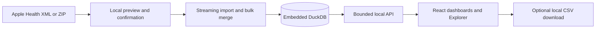

# Architecture

Apple Health Analyzer is a single-user desktop web application. A loopback Python process owns the profile, import staging, and query policy. The same process serves the built Vite application. The frontend uses React and TypeScript, without storing health observations in browser storage.

## Module boundaries

| Layer | Responsibility |
| --- | --- |
| `ingest/` | Select and validate input, parse direct export children, and coordinate one transactional write. |
| `storage/` | Evolve the DuckDB schema, batch data, preserve record identity, and merge provenance. |
| `services/` | Own metric labels, units and policy inputs. Legacy statistical helpers are library code. |
| `api/` | Own local staging, the v1 HTTP contract, and parameterized DuckDB read models. |
| `frontend/` | Own navigation, import interactions, accessible chart rendering, and descriptive comparisons of returned series. |

The metric Explorer returns at most 3,650 daily buckets or fewer weekly or monthly buckets. Raw observations are paged and limited to 200 per request. One chart path handles dense series, with individually rendered sample dots limited to small series. Aggregation takes place in DuckDB, and the frontend uses the returned series for distribution and paired comparison.

One process and one writer are supported for a given profile. The importer serializes write transactions. Read requests use independent DuckDB connections in the same process. Queries favor direct SQL over precomputed views while measured query latency remains interactive. Parallel import processes, multiple users, and a remote deployment are outside the design.

## Privacy model

The supported CLI binds only to loopback and disables request access logs so health filters stay out of console output. The API checks the request host and browser origin, and sends `Cache-Control: no-store` for API responses. OpenAPI is served as local JSON. Vite proxies the development client to the local API. The app stores the theme preference in browser local storage. It makes no runtime calls to external services. Dependencies are fetched during setup.

Access to the computer or profile files is the trust boundary. The database, staged files, original export, and downloaded CSVs rely on operating-system access controls and any disk encryption the user has enabled. Use a working directory outside synchronized storage for device-only retention. Deleting files does not guarantee secure erasure.

See [architecture decision](REBUILD_DECISION.md), [data pipeline](DATA_PIPELINE.md), and [privacy and deletion](../PRIVACY.md).
